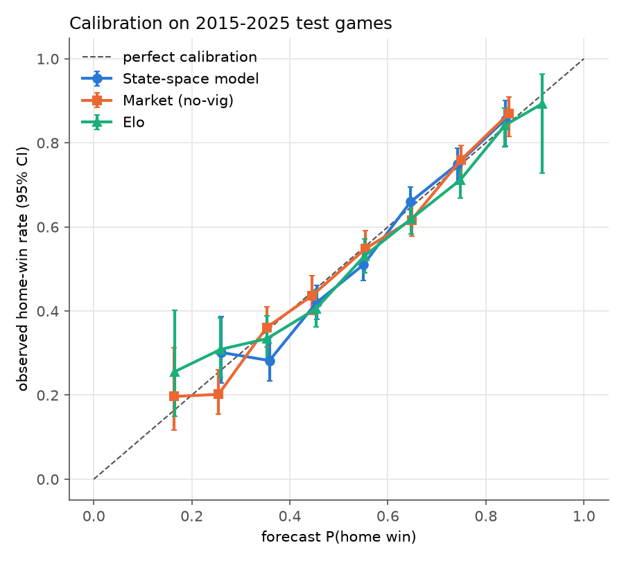
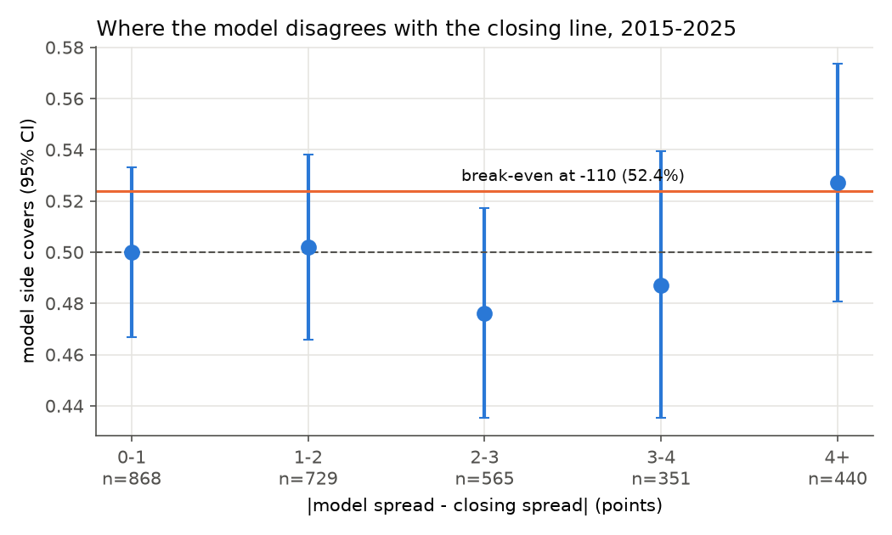
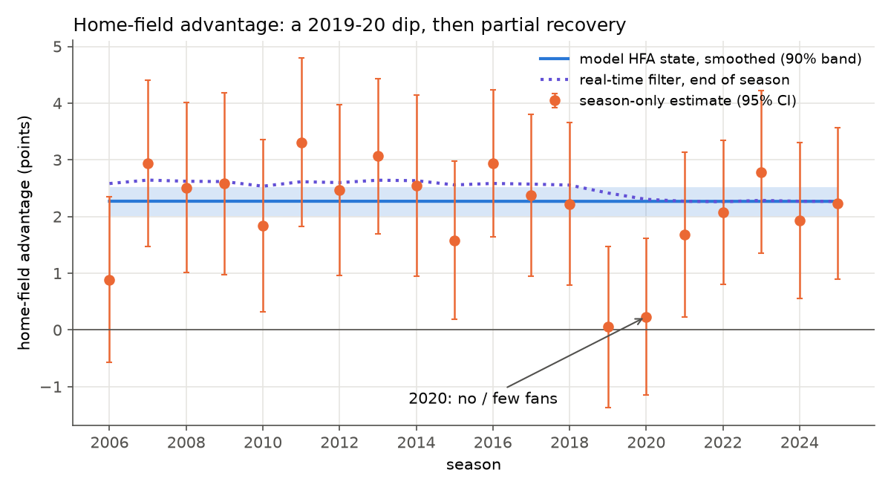
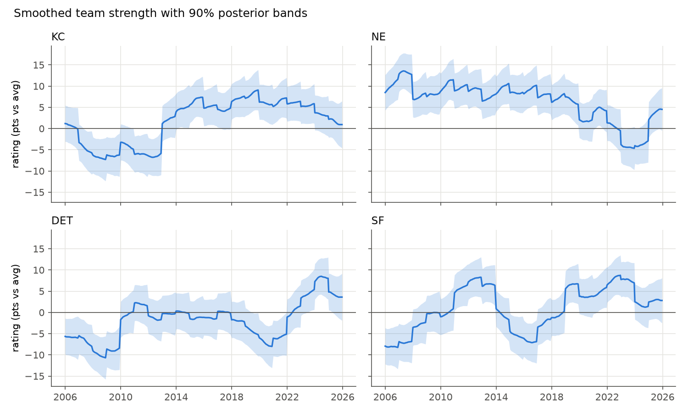

# NFL Game Forecasting with a Kalman-Filter Team-Strength Model

[](https://github.com/lukahere007/nfl-game-forecasting/actions/workflows/ci.yml)

[](LICENSE)

**Question.** Can a principled, transparent team-strength model forecast NFL games as well as the Las Vegas closing line? And where does it disagree with the line?

**Short answer: no, and that is the expected result.** On 3,018 test games (2015–2025, regular season and playoffs, predicted strictly week by week), the model beats a 538-style Elo rating and a home-team baseline, but it is clearly worse than the closing line. The games where it disagrees most with the line are mostly games where the market knows something the model doesn't, such as a backup quarterback or starters being rested in the last week of the season. Betting those disagreements would not have beaten the vig.

## Results (test seasons 2015–2025, 3,018 games, 10 ties excluded)

| Forecaster | Log loss ↓ | Brier ↓ | Accuracy | Spread MAE vs result (pts) |
|---|---|---|---|---|
| Home team, training base rate (56.9%) | 0.689 | 0.248 | 55.0% | 11.00 |
| Elo, 538-style (K = 20, HFA = 55, tuned on 2006–14) | 0.636 | 0.222 | 64.3% | 10.21 |
| State-space, ratings only (no QB/rest terms) | 0.638 | 0.223 | 63.4% | 10.23 |
| State-space, hyperparameters frozen at 2006–14 | 0.633 | 0.221 | 64.4% | 10.16 |
| **State-space, walk-forward** (re-tuned each year on past seasons) | **0.632** | **0.221** | 64.1% | 10.16 |
| **Market**: no-vig closing moneyline | **0.612** | **0.212** | 66.2% | 9.82 (closing spread) |

- **The market is hard to beat.** The model's log loss is **0.020 worse** than the market's (95% CI 0.014 to 0.026, bootstrap over weeks). That gap is about four times the model's lead over Elo.
- **The model edges out Elo,** but only by 0.0037 in log loss (95% CI −0.0087 to +0.0012), so the lead is not statistically clear. The QB-change and rest terms account for the whole edge. Without them, the state-space ratings slightly *trail* Elo.
- **The model tracks the line closely.** Its predicted spread correlates 0.89 with the closing spread, with a mean absolute gap of 2.2 points. In a regression of the actual margin on the line plus the model's disagreement, the disagreement coefficient is 0.10 ± 0.09. That is not distinguishable from zero, so the model adds no detectable information beyond the line.
- **Against the spread, the model's side covers 49.8%** of 2,953 non-push games (95% CI 48.0–51.7%). Break-even at −110 is 52.4%. Even on the 440 games where the model and the line differ by 4+ points, it covers 52.7% (95% CI 48.1–57.3%), so there is no evidence of an edge. The model's cover probabilities are also *worse than a coin*: log loss 0.708 against 0.693.



All three forecasters are reasonably well calibrated. The market wins on *sharpness*: it is confidently right more often.

### Where model and market disagree most

| Game | Closing line (home) | Model (home) | Result (home) | What the model didn't know |
|---|---|---|---|---|
| 2017 wk 17 SF @ LA | −6.5 | +12.0 | −21 | Rams rested starters (Mannion at QB) |
| 2020 wk 17 LAC @ KC | −7.0 | +9.9 | −17 | Chiefs rested Mahomes (Henne at QB) |
| 2023 wk 18 PIT @ BAL | −3.0 | +13.0 | −7 | Ravens rested Lamar Jackson (Huntley at QB) |
| 2019 wk 17 PIT @ BAL | −2.0 | +12.0 | +18 | Ravens rested starters, won anyway |
| 2025 wk 17 DEN @ KC | −13.5 | −0.5 | −7 | KC started backup QB Chris Oladokun |

(Signs follow nflverse: positive means the home team is favoured or won. Full list: `results/top_disagreements.csv`. The starting-QB names come from the data; the "rested starters" context is general sports knowledge, not something this repo's data records.)

Games with a 4+ point disagreement are **2.1×** as likely to fall in the final regular-season week (12.5% vs 5.8% of all games), and 41.5% of them involve a non-usual starting QB (28.1% overall). The model's QB term is a single average shift (−1.8 to −2.8 points, re-estimated each year). The market prices *which* QB is playing and whether a team has anything to play for.



### Home-field advantage and the 2020 natural experiment



The model lets HFA drift between seasons as a random walk. Maximum likelihood sets that drift variance to about 0: across 2006–2025 there is no evidence of a *gradual* trend once game noise is accounted for. Looking at each season on its own tells a sharper story. HFA was **2.4 ± 0.2 points** in 2006–2018, collapsed to **0.1 ± 0.7 in 2019** and **0.2 ± 0.7 in 2020** (the season with few or no fans), and has since recovered to **2.1 ± 0.3** (2021–2025). The 2020 dip fits the crowd story, but HFA was already near zero in 2019, before COVID, so 2020 alone cannot prove that crowds cause HFA. A random walk is the wrong shape for a dip followed by a rebound, which is why the smoothed state stays flat. Modelling this properly (for example, a known-in-advance "no fans" indicator) is listed under next steps.

### Team ratings with uncertainty



These are smoothed posterior ratings (RTS smoother, all data) with 90% bands. You can see the Chiefs' jump when Andy Reid arrived in 2013, the Patriots' fall after Brady left in 2020, and Detroit's rise from 2022. The bands widen every off-season, when the model knows least.

## What's creative here

**A Kalman filter for team strength.** Think of each team's strength as a ship's position tracked by dead reckoning. Between games, the ship drifts, so uncertainty grows a little every week and a lot over the off-season, when rosters turn over. Each game result is a noisy sighting: a 13-point win is evidence, but games have about 13 points of noise. The filter combines the two in exactly the right proportions. A team you're unsure about (start of season, new roster) moves a lot after one game. A team you've watched for 12 weeks barely moves. Elo has to hand-tune this with a "K-factor". Here it falls out of Bayes' rule.

Concretely (`src/nflstate/kalman.py`):

- **State:** 32 team ratings (points better than an average team on a neutral field), plus league-wide HFA.
- **Dynamics:** a weekly random walk, and in the off-season `rating ← ρ·rating + noise` (regression to the mean). HFA gets its own season-to-season drift.
- **Observation:** `home margin = r_home − r_away + HFA·(not neutral) + β_qb·(QB change diff) + β_rest·(rest diff in weeks) + N(0, σ²)`.
- **Exact inference:** the model is linear and Gaussian, so the filter's posterior is the exact Bayesian answer, not an approximation. All games in a week share one prior and are absorbed in one joint update, so a week-*w* forecast never sees a week-*w* result.
- **Empirical-Bayes hyperparameters:** σ, weekly and off-season variances, ρ, HFA drift, β_qb and β_rest are chosen by maximising the product of one-step-ahead predictive densities on training seasons. That makes the fitting criterion itself a forecasting score. Each test season is re-tuned using only earlier seasons.
- **Full predictive distribution:** each game gets `margin ~ N(μ, s²)`, where `s²` includes both rating uncertainty and game noise. Win probability, predicted spread and cover probability all come from that one distribution.

The fitted values are interpretable. Using the 2006–2014 fit: σ = 13.0 points per game, weekly rating drift SD 0.46 points, an off-season carry-over of ρ = 0.69 with an extra 3.6-point SD shock, a starting QB who isn't the usual one costs **1.8 points** (2.8 by the 2025 re-fit), and each extra week of rest is worth **1.4 points**.

## Evaluation design

- **2002–2005: burn-in.** Ratings move, but nothing is scored.
- **2006–2014: training.** Hyperparameters, Elo's K and HFA, and the spread-to-probability scale are all fit here.
- **2015–2025: test, strictly walk-forward.** For season S, hyperparameters are re-fit on 2006…S−1 (`results/walkforward_params.csv`), and the filter predicts each week using only earlier weeks.
- **Market benchmark:** the closing moneyline with the vig removed proportionally (median overround 2.7%), available for 99.97% of test games. For the one test game without it, a closing-spread mapping `Φ(spread/11.5)` is used, with the 11.5 fitted on training seasons. The closing line is the *hardest* benchmark, because it has absorbed all injury, weather and betting information up to kickoff.
- **Scoring:** log loss and Brier score for winners, MAE for spreads, reliability diagrams, a week-block bootstrap for confidence intervals, and Wilson intervals for against-the-spread rates.

## Tests

`pytest` (22 tests, about 2 s) checks:

- **Kalman correctness:** a one-game update against closed-form Gaussian conditioning *and* brute-force 2-D grid integration; a batch week update equals sequential updates; the RTS smoother and summed predictive log-likelihood on a toy two-team, three-step system (with a season transition) equal the answer from conditioning the full stacked joint Gaussian; `run_filter` matches hand-rolled primitives.
- **No leakage:** scrambling every result from week *w* onward leaves all predictions up to and including week *w* unchanged, for both the Kalman filter and Elo (and the test also checks that later weeks *do* change). QB-change flags depend only on earlier games.
- **Market maths:** American odds to probability, vig removal (−110/−110 → 50/50; −200/+170 → 64.3%), and recovery of the spread-to-probability scale on simulated data.
- **Scoring helpers** and **data cleaning:** franchise relocation mapping and QB-change flags on a toy schedule.

## Reproduce

```bash
git clone https://github.com/lukahere007/nfl-game-forecasting.git
cd nfl-game-forecasting
python -m venv .venv && source .venv/bin/activate   # Windows: .venv\Scripts\activate
pip install -r requirements.txt

python scripts/fetch_data.py          # downloads games.csv -> data/processed/games.parquet
pytest -q                             # unit tests
python scripts/run_analysis.py        # full walk-forward run, ~5 min on a laptop CPU
python scripts/run_analysis.py --fast # reuse committed yearly hyperparameters, ~2 min (what CI runs)
```

The cleaned data (`data/processed/games.parquet`, 0.2 MB) is committed, so the analysis runs without downloading anything.

## Repository layout

```
├── data/processed/games.parquet   # cleaned 2002-2025 games (committed); data/raw/ is git-ignored
├── figures/                       # PNGs generated by run_analysis.py
├── results/                       # metrics, test-set predictions, hyperparameters, disagreement tables
├── scripts/
│   ├── fetch_data.py              # download + clean nflverse games.csv
│   └── run_analysis.py            # walk-forward evaluation, tables, figures
├── src/nflstate/
│   ├── data.py                    # cleaning, franchise mapping, QB-change flags
│   ├── kalman.py                  # Kalman filter, RTS smoother, NFL state-space model
│   ├── model.py                   # empirical-Bayes hyperparameter fitting
│   ├── elo.py                     # 538-style Elo baseline
│   ├── market.py                  # odds -> probability, vig removal, spread mapping
│   ├── evaluate.py                # scoring rules, calibration, bootstrap, ATS
│   └── plots.py
├── tests/                         # pytest suite
└── .github/workflows/ci.yml       # tests + fast analysis on every push
```

## Limitations and next steps

- **The QB term is a crude average.** It treats a backup replacing Mahomes the same as one replacing a journeyman. A per-QB rating (a second state vector), or using the QB's own prior EPA, would target exactly the games where the model is most wrong.
- **There is no "nothing to play for" signal.** Final-week games with resting starters dominate the biggest misses. A playoff-clinch indicator, computable before kickoff from the standings, would help.
- **Starting QBs are known shortly before kickoff,** and the market sees the same information by close. The flag uses the actual starter from nflverse, so it is "pre-game" but late-breaking.
- **Margins are not Normal.** NFL scores cluster on key numbers (3, 7), so cover probabilities near the line are approximate. A discrete margin distribution would fix this.
- **HFA is shared by every team** and modelled as a random walk. Team-specific HFA, and a 2020-style "no crowd" covariate, are natural extensions.
- **Closing lines, not tradeable prices.** Beating the closing line in hindsight is not the same as betting profitably: real bets are placed earlier, at prices carrying ~4.8% overround at −110. Nothing here is a betting recommendation.
- **Single data source.** All lines come from the one compilation in nflverse, and moneylines are missing for some 2006–2009 training games (spread-mapped instead).

## Data and licences

- Game results, closing lines, rest days and starting QBs come from the **nflverse** [`nfldata`](https://github.com/nflverse/nfldata) `data/games.csv`, maintained by Lee Sharpe and the nflverse team. The `nfldata` repository does not state a licence file; check nflverse's terms before redistributing. This repo commits only a small cleaned derivative.
- Code: MIT licence © 2026 Luke Wamalwa.
